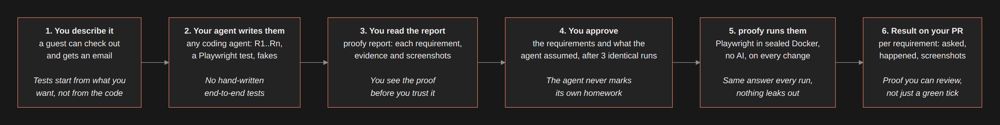

# proofy

[](https://www.npmjs.com/package/@davidrydberg/proofy)
[](LICENSE)

**Sealed end-to-end tests that your coding agent writes and you approve.**

`proofy` gives your app end-to-end tests you can trust.
You describe what to test in plain words.
Your agent follows the instructions proofy puts in your repo to write numbered requirements, a Playwright test and fakes for outside services.
You approve them, and every `proofy run` checks the app in a sealed Docker sandbox, with no AI.
The report shows, per requirement, what was asked, what happened and the evidence, with screenshots.

## Install

```sh
npm i -g @davidrydberg/proofy
```

## Quick start

Add `e2e/` to your repo:

```sh
proofy init     # adds e2e/ with agent instructions, templates and a config filled from your repo
```

Then tell your agent what to test, in one sentence: "add a proofy test: a guest can buy a product and gets a confirmation email".
It finishes setup if needed, writes `e2e/specs/<flow>.md` and the test, and runs it until three runs agree, without stopping to ask.
Whatever you did not say, it picks and lists under `## Assumed` in the spec, so you review everything once: read the report, then approve.

```sh
proofy                            # setup, every flow's state and the next step; safe for a session-start hook
proofy report                     # you: the latest run, each requirement with what happened; screenshots in report.md
proofy approve guest-checkout     # you: shows results, the agent's assumptions and gaps, then asks you to type the name
proofy run --all                  # every approved flow in a fresh sealed sandbox
proofy run --all --pr 42 --post   # a pull request's code, report posted on the PR
```

A passing run looks like this:

```
PASS  every requirement of every approved flow held
run 20261020-091512  e2e/out/20261020-091512

guest-checkout  passed
  ✓ R1   After placing the order, the guest sees a confirmation page showing the stored order's number.
  ✓ R2   The order is stored with status "processing", payment method cash on delivery, ...
  ✓ R3   Within 30 seconds the guest receives exactly one email, and it shows the order number.
  ✓ R4   Stock for the coffee goes down by exactly one.
  ✓ R5   No email that names the guest or the order number goes to anyone but the guest or the shop ...
```

See [`examples/woocommerce`](examples/woocommerce) for a complete shop with two flows, and [pull request 1](https://github.com/davidrydberg/proofy/pull/1) for a report posted with `--post`.

## How it works



## Trust model

### The sealed sandbox

The sandbox has no way out.

- Every outside call to a hostname goes to a fake the agent wrote from the provider's docs, gets recorded, or is refused.
- The report lists every HTTP and HTTPS call, and every name the app looked up without calling it over HTTP.
- Calls to a raw IP address reach nothing and are not listed.
- The app cannot read or erase the evidence: the fakes' recorded calls and Mailpit's API answer only the tests, with a token new for every sandbox.
- A volume's fixed `name` is dropped, so the sandbox never reuses or deletes a volume of the app's own.

### Environment

- The app's settings come only from `e2e/proofy.json` and the compose files, never from your shell's environment or a `.env` file.
- proofy refuses a compose variable that would be blank where it reaches the app.
- proofy refuses any use of a variable Docker itself needs, even with a default: `PATH`, `HOME`, `DOCKER_*`, `BUILDX_*`, `XDG_RUNTIME_DIR`, and `HTTP_PROXY`, `HTTPS_PROXY`, `NO_PROXY` and `ALL_PROXY` in either case.
- Only an image build may take a proxy variable, in `build.args`.

### Refused compose settings

proofy refuses to start a service whose compose settings would break the seal:

- **Service settings:** `network_mode`, `privileged`, `cap_add`, `devices`, a `pid`, `ipc`, `uts` or `userns_mode` of the host or a `container:`, and `volumes_from` a `container:`.
- **Image build:** `build.ssh`, `build.secrets`, `build.privileged` and `build.entitlements`.
- **Host files:** a build context, `build.additional_contexts` folder, bind mount, secret or config file outside the repository, with symlinks resolved.
- **Volumes:** a volume that is `external`, sets `driver_opts`, or sets a `driver` other than `local`.
- **Docker socket:** a mount of the Docker or containerd socket, also as a secret or config file.

### Approvals

- An approval covers the flow's requirements, its test and every other file in `e2e/tests/` but other flows' tests, every file in `e2e/standins/`, `e2e/proofy.json`, and the compose files it lists with the files they include or extend.
- A change to any of them makes the flow out of date until you approve it again, and `proofy` and the run report say what changed.
- Only you run `proofy approve`: it works only in an interactive terminal and asks you to type the flow name.
- That stops an agent that follows its instructions, not a determined one with shell access, which can fake a terminal or write `e2e/proofy.lock.json` itself.
- So `proofy run --pr` lists every flow whose approval changed in the pull request, and you check each one in review.
- For a stronger gate, add a CODEOWNERS entry for `e2e/proofy.lock.json`.

## Exit codes

| Code | Meaning |
|---|---|
| 0 | Pass |
| 1 | An approved flow failed |
| 2 | Usage or config |
| 3 | The sandbox failed |
| 4 | Not approved |

## Requirements

- Node 24 or newer
- Docker on macOS or Linux (Docker Desktop, OrbStack or Docker Engine)
- An app that starts with `docker compose`; your agent can draft the compose file
- The [GitHub CLI](https://cli.github.com), only to test pull requests or post reports on them

## Contributing

See [CONTRIBUTING.md](CONTRIBUTING.md). Report security issues privately, as described in [SECURITY.md](SECURITY.md).

## License

[MIT](LICENSE)
