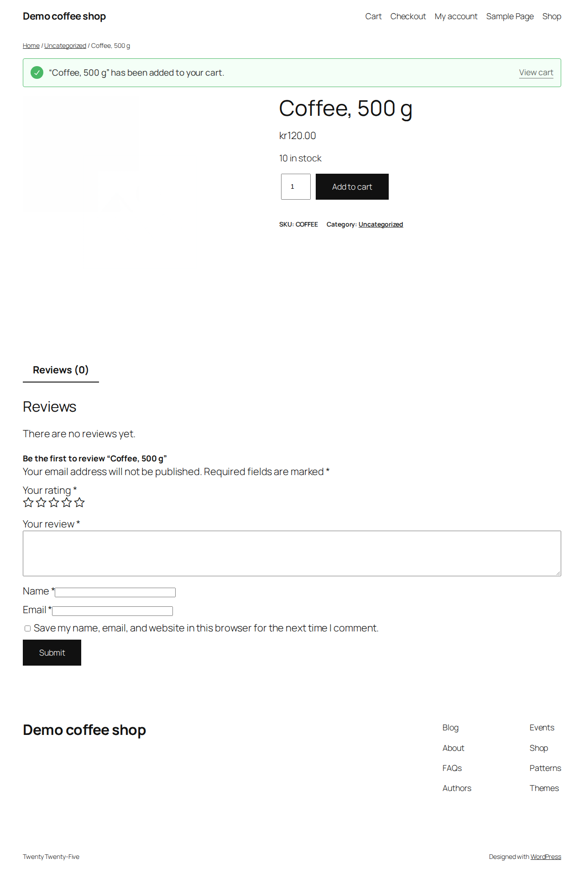
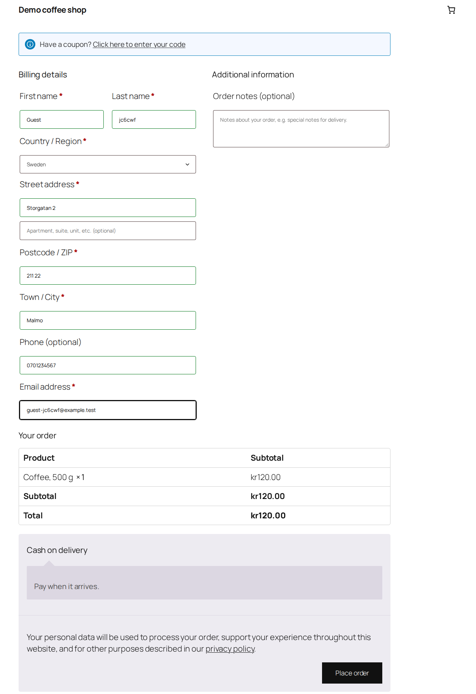
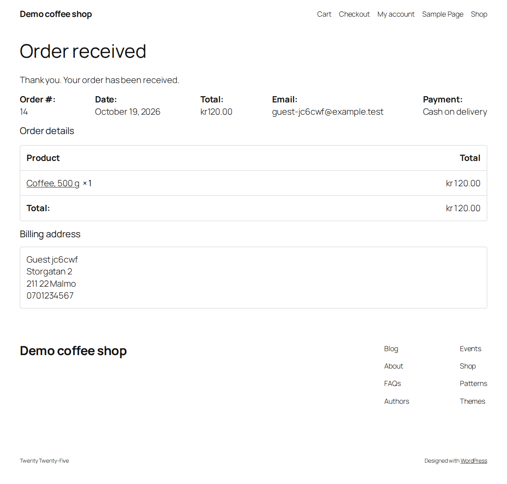

## proofy: NOT TRUSTED: some flows are not approved, so their results prove nothing yet

Run 20261019-232741 (run), PR #1, commit d2195bad68b5. Sealed: the app had no way out; every outside call went to a fake or was refused.

| Flow | Result | Approved |
|---|---|---|
| guest-checkout | passed (5 pass) | no, result not trusted |

### guest-checkout

| Req | Result | Requirement | What the test did | Expected | Actual | Relied on fakes |
|---|---|---|---|---|---|---|
| R1 | pass | After placing the order, the guest sees a confirmation page showing the stored order's number. | placed the order and read the stored order | confirmation page showing order 14 | shows order 14 | none |
| R2 | pass | The order is stored with status "processing", payment method cash on delivery, one line of one coffee, a total of 120.00 SEK, the guest's email as billing email, and no customer account. | read order 14 with wp-cli | processing, cod, 1 x COFFEE, 120.00 SEK, billed to guest-jc6cwf@example.test, no account | processing, cod, 1 x COFFEE, 120.00 SEK, billed to guest-jc6cwf@example.test, customer 0 | none |
| R3 | pass | Within 30 seconds the guest receives exactly one email, and it shows the order number. | read guest-jc6cwf@example.test's mail | exactly one email showing order 14 | 1 email(s): Your Demo coffee shop order has been received! | none |
| R4 | pass | Stock for the coffee goes down by exactly one. | read the coffee's stock before and after | 9 | 9 | none |
| R5 | pass | No email that names the guest or the order number goes to anyone but the guest or the shop (owner@shop.test), not even as a copy (cc or bcc). | found every email naming the guest or the order, with cc and bcc | only guest-jc6cwf@example.test and owner@shop.test | guest-jc6cwf@example.test, owner@shop.test | none |

<details><summary>Evidence</summary>

R2:

```json
{
  "status": "processing",
  "payment_method": "cod",
  "line_items": [
    {
      "id": 1,
      "name": "Coffee, 500 g",
      "product_id": 13,
      "variation_id": 0,
      "quantity": 1,
      "tax_class": "",
      "subtotal": "120.00",
      "subtotal_tax": "0.00",
      "total": "120.00",
      "total_tax": "0.00",
      "taxes": [],
      "meta_data": [
        {
          "id": 10,
          "key": "_reduced_stock",
          "value": "1",
          "display_key": "_reduced_stock",
          "display_value": "1"
        }
      ],
      "sku": "COFFEE",
      "global_unique_id": "",
      "price": 120,
      "image": {
        "id": "",
        "src": ""
      },
      "parent_name": null
    }
  ],
  "total": "120.00",
  "currency": "SEK",
  "billing_email": "guest-jc6cwf@example.test",
  "customer_id": 0
}
```

</details>

<details><summary>Screenshots</summary>

coffee added to the basket



checkout filled in



order confirmation



</details>
